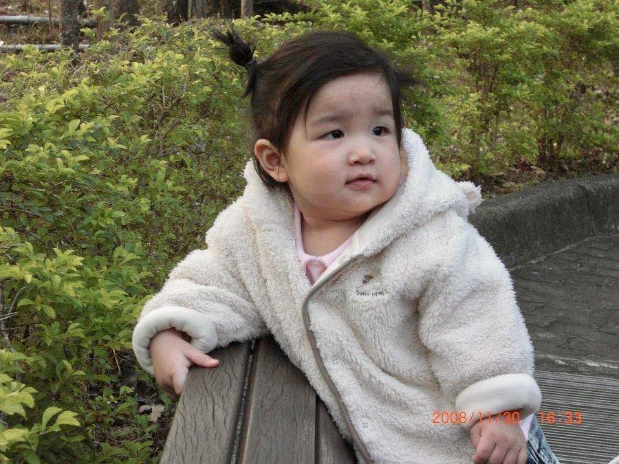
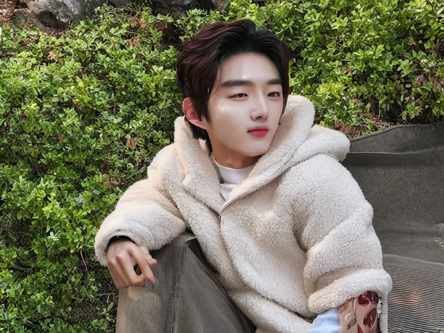
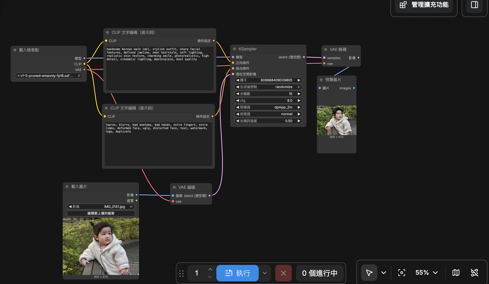

# ComfyUI 圖生圖

## 原圖

## 生成的圖

## 完整工作流截圖

## 提示詞
*   **🟢 正向提示詞 (Positive Prompt)**
    handsome Korean male idol, stylish outfit, sharp facial features, defined jawline, perfect hair, photorealistic, 8k, masterpiece
    
*   **🔴 反向提示詞 (Negative Prompt)**
    lowres, blurry, bad anatomy, bad hands, extra fingers, extra limbs, deformed, ugly

## 個人心得
蠻好玩的，只是有點複雜。花了好多時間但感覺還是沒什麼搞懂，不過看到自己的照片能成功轉變成帥氣的風格，非常有成就感！希望之後能多摸索一下各個節點的功能。